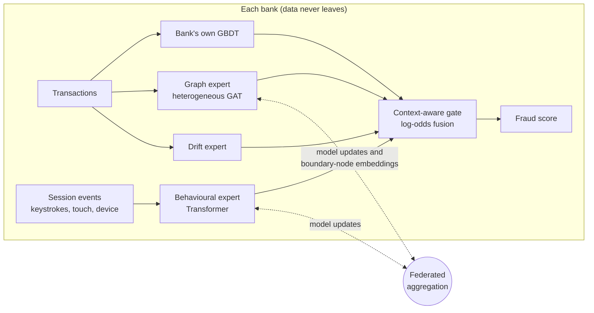

# Federated-MARTI

**Cross-bank fraud and money-laundering detection without sharing customer data.**
Federated graph learning, behavioural biometrics and drift adaptation, fused on top of each bank's own model.

> **Research preview.** The paper is in preparation. This repository publishes the problem, the design, the verified results and the **complete synthetic-data generator** the results were obtained on. The model and training code will be released in **mid-2027**.

---

## The problem

Fraud rings and money mules spread across banks: money stolen at one bank is moved through mule accounts at others within hours. Each bank sees only its own slice of the network and its own customers' devices, and privacy law stops banks from pooling transaction or biometric data. A model trained by one bank alone misses the cross-bank pattern.

## The approach



- **Graph expert:** a heterogeneous graph attention network over accounts, devices and transfers. Accounts at other banks appear as boundary nodes, so mule chains that cross banks become visible without exchanging raw records.
- **Behavioural expert:** a Transformer over raw session events (typing rhythm, touch pressure, swipes, pauses) that tells a coerced customer or a remote-controlled phone from the genuine user.
- **Drift expert:** adapts to app releases and new fraud patterns.
- **Gate:** fuses the experts with the bank's existing gradient-boosted model, so every bank keeps at least the performance of what it already runs.
- **Privacy:** optional differential privacy on the shared experts; under DP the fusion stays inside each bank.

## Results (synthetic benchmark, 8 banks)

| Model | PR-AUC (test, Nov–Dec 2024) |
|---|---|
| Rule system | 0.184 |
| Each bank's own GBDT | 0.883 |
| **Federated-MARTI** | **0.924 ± 0.001** |
| Pooled data, upper bound (not deployable) | 0.962 |

- **+0.040 PR-AUC** over each bank's own model (95% CI [+0.032, +0.052]), improving **every bank in every seed**.
- Federation closes **50%** of the gap between training alone and pooling all data.
- At the rule system's alert volume, it catches **73.5%** of fraud against the rules' **27.4%**.
- **18.3 ms** p95 end-to-end latency at 100 transactions per second.

**What did not work, reported as such:** with differential privacy at ε ≤ 4.83 the private experts add no measurable gain over each bank's own model. On the real Elliptic Bitcoin graph, the graph expert alone (F1 0.50) is far weaker than a random forest (0.81), which is why the final design keeps each bank's GBDT. First-party fraud stays hard (PR-AUC 0.077).

Full tables, confidence intervals, robustness checks and operations metrics: [`docs/RESULTS.md`](docs/RESULTS.md).

> **Read these numbers carefully.** They come from synthetic data. Banks cannot release keystroke, touch or device telemetry, because it is personal and often biometric data, so the benchmark had to be generated. The results show feasibility under controlled conditions; they are not an estimate of production performance.

## What is in this repository

| Path | Content |
|---|---|
| `generator/generate_federated_marti_v2.py` | The full, seeded generator: 8 banks, 40,630 customers, 1.16 million transactions, 7 fraud types with realistic mechanics, behavioural biometrics, drift, and per-bank shards with bank-salted pseudonyms |
| `generator/validate_dataset.py` | Sanity, leakage and separability checks, including a gradient-boosting baseline and an identifier-leakage probe |
| `docs/DATA_CARD.md` | What the data contains, how the biometrics are calibrated, fraud mechanics and signatures, validation results, limitations |
| `sample_data/` | A small sample (2,000 customers) to explore without running the full generator |
| `notebooks/01_explore_synthetic_data.ipynb` | A walk through the sample: fraud mix, cross-bank flows, biometric signatures, temporal split |
| `docs/RESULTS.md` | Verified model results |

### Generate the data

```bash
pip install -r requirements.txt
python generator/generate_federated_marti_v2.py --out ./fmarti_v2 --customers 40000 --banks 8 --seed 42
python generator/validate_dataset.py ./fmarti_v2
```

The full run takes about 7 minutes on 2 CPU cores and needs about 4 GB of RAM. `--sophistication 2` makes the fraud harder to detect (more victim-mimicking); `--fraud-scale` lowers prevalence towards real-world levels.

### Why release the generator before the model

The data is the part reviewers trust least, so it is released first. Anyone can regenerate the exact benchmark, check that it is not tuned to flatter the model, and test their own methods against the same baseline: a plain gradient-boosted model already reaches PR-AUC 0.88 on it. Public multi-bank fraud datasets with behavioural biometrics are also very rare.

## Roadmap

- [x] Synthetic multi-bank benchmark with behavioural biometrics (v2)
- [x] Federated-MARTI: experts, gate, federated training, DP variant, serving API
- [x] Verified results on 3 seeds, robustness populations and Elliptic
- [ ] Make differential privacy useful at practical privacy budgets
- [ ] Manuscript submission
- [ ] **Mid-2027:** model code, training pipeline and serving API

## Author

**Ayoub Amekzaz** · B.Sc. (Hons) Data Science, Cyprus International University · ayoub1am@icloud.com

Copyright © 2026 Cyprus International University. Generator code: MIT license (see `LICENSE`). Generated data: CC BY 4.0, attribution to Cyprus International University and the author.
